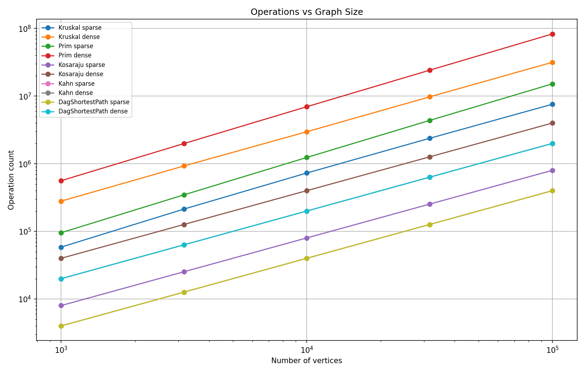
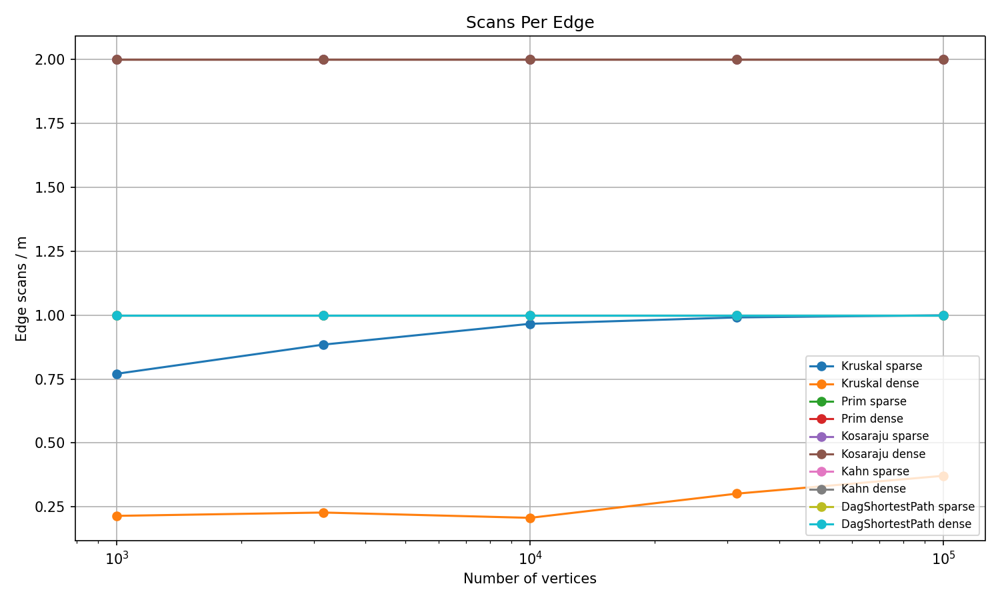
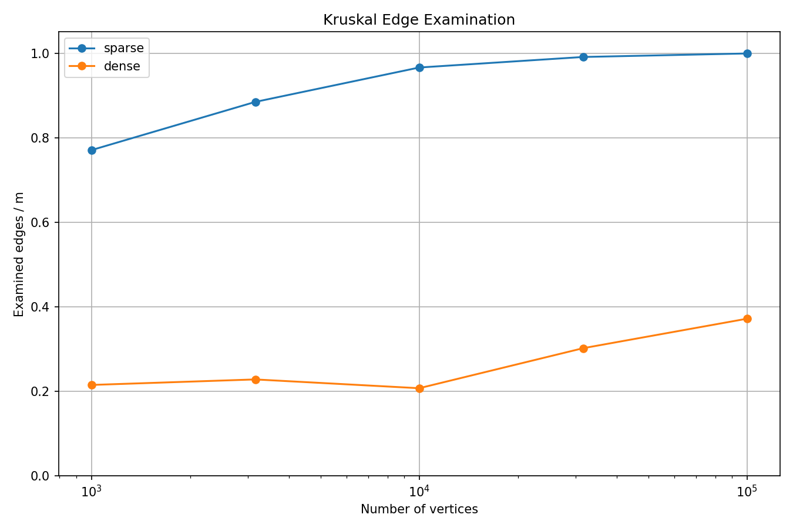

# Graph Algorithms — Assignment 3

**Student:** Sanzhar Zhakanov  
**Group:** SE-2526  
**Course:** Design and Analysis of Algorithms

## 1. Introduction

This project implements graph algorithms in Java. The main tasks are finding minimum spanning trees, strongly connected components, topological ordering and shortest paths in directed acyclic graphs.

The project uses adjacency lists for graph storage. Both directed and undirected graphs are supported. The algorithms also collect operation counters to study their complexity.

## 2. Complexity Analysis

| Algorithm | Time Complexity | Extra Space | Explanation |
|---|---|---|---|
| DSU find/union | O(α(V)) amortized | O(V) | Path compression and union by size keep operations efficient. |
| Kruskal | O(E log E) | O(V + E) | Edges are sorted, and DSU prevents cycles. |
| Prim | O((V + E) log(E + 1)) | O(V + E) | A priority queue selects the next minimum edge. |
| Kosaraju | O(V + E) | O(V + E) | Two DFS passes and a reversed graph are used. |
| Kahn | O(V + E) | O(V) | Each vertex and edge is processed once. |
| DAG Shortest Paths | O(V + E) | O(V) | Edges are relaxed in topological order. |

Here V is the number of vertices and E is the number of edges. DSU uses the inverse Ackermann function α(V), which grows extremely slowly. Initializing the DSU takes O(V).

## 3. Correctness

### Minimum Spanning Tree

The cut property states that a minimum-weight edge crossing a cut is safe to include in a minimum spanning tree. Kruskal processes edges in increasing weight order. It adds an edge only if its endpoints belong to different DSU components. This prevents cycles while connecting previously separate parts of the graph. Prim starts from a vertex and repeatedly chooses the lightest edge connecting the current tree to an unvisited vertex. Both algorithms use safe edges according to the cut property. Therefore, they produce minimum spanning trees with the same total weight, although the selected edges may differ.

### DAG Shortest Paths

A directed acyclic graph has a topological ordering. Every edge goes from an earlier vertex to a later vertex in this order. Initially, vertices with zero in-degree receive distance zero because they are the possible starting points. Assume that all vertices before the current vertex already have correct shortest distances. All incoming edges of the current vertex have already been considered, so its distance is also correct. Relaxing its outgoing edges updates the distances of later vertices. By induction, one pass through the topological ordering calculates all shortest distances. Negative weights are safe because a DAG cannot contain a negative cycle.

## 4. Measurements

The benchmark uses graph sizes of 1,000, 3,162, 10,000, 31,623 and 100,000 vertices. Each size is tested with 4n and 20n edges. Every algorithm is executed five times, and the median execution time is recorded.

Operation counts are used as the main evidence because they are more reproducible than execution times. The measured ratios and log-log slopes are calculated from `results/results.csv`.

## 5. Algorithm Choice

| Situation | Algorithm | Reason |
|---|---|---|
| Sparse undirected graph with an edge list | Kruskal | Sorting edges and using DSU is convenient. |
| Dense undirected graph with adjacency lists | Prim | It grows the tree directly from adjacent vertices. |
| Repeated connectivity operations | DSU | Efficient union and find operations. |
| Directed graph with possible cycles | Kosaraju | Finds strongly connected components. |
| Job scheduling with dependencies | Kahn | Produces a topological order and detects cycles. |
| Shortest paths in a DAG | DAG Shortest Paths | Linear-time solution, including negative weights. |
| General graph with negative weights | Bellman-Ford | Handles negative edges and detects reachable negative cycles. |

Kruskal is convenient when an edge list is already available. Prim is useful with adjacency lists, although the performance difference also depends on the graph density and priority queue implementation.

## 6. Plots

### Operations vs Graph Size

This plot compares the recorded work as the number of vertices increases. The log-log scale makes growth rates easier to compare.

### Scans Per Edge

Kosaraju scans 2E edges across its two DFS passes. Kahn and DAG relaxation each scan E edges. Their ratios remain constant as graph size increases.

### Kruskal Edge Examination

Kruskal sorts the edges and examines them until the spanning tree is complete. The share of examined edges can differ between sparse and dense graphs.

## 7. Execution Time

The benchmark records the median of five runs for every algorithm and graph configuration. Execution times depend on the CPU, JVM, memory management and other running programs. Small graphs are especially affected by measurement noise. For this reason, time measurements are included for comparison, but operation counters are used to support the complexity analysis.

## 8. Conclusion

The implementations demonstrate different approaches to graph problems. Kruskal and Prim solve the minimum spanning tree problem, Kosaraju finds strongly connected components, Kahn handles topological sorting, and DAG relaxation finds shortest paths.

The tests compare algorithms against independent implementations and check special cases. The benchmark checks reference results and records operation counts for different graph sizes.